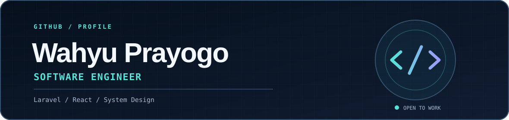

  <picture>
    <source media="(prefers-color-scheme: dark)" srcset="./dark.svg" />
    <source media="(prefers-color-scheme: light)" srcset="./light.svg" />
    
  </picture>
    
  <strong>Hi, I'm Wahyu 👋</strong>
   
  I design how web applications work, build their backend with Laravel, and create interfaces with React.
    
  <strong>Open to software engineering opportunities.</strong>

## About me

I enjoy working on a product from its first system diagram to the final interface. **Laravel** and **system design** are my strongest areas. I also care about clear user flows and solid performance.

## Tech stack

**Backend, data & infrastructure**

  &nbsp;
  &nbsp;
  &nbsp;
  &nbsp;
  &nbsp;
  
   
  PHP · Laravel · Go · MySQL · Docker · Nginx

**Frontend**

  &nbsp;
  &nbsp;
  &nbsp;
  &nbsp;
  &nbsp;
  &nbsp;
  
   
  JavaScript · TypeScript · React · HTML · CSS · Tailwind CSS · Bootstrap

**Architecture:** system design and business workflow planning.

## GitHub statistics

  <picture>
    <source media="(prefers-color-scheme: dark)" srcset="https://github-readme-stats.vercel.app/api?username=WahyuPrayogo1&amp;show_icons=true&amp;theme=tokyonight" />
    <source media="(prefers-color-scheme: light)" srcset="https://github-readme-stats.vercel.app/api?username=WahyuPrayogo1&amp;show_icons=true&amp;theme=default" />
    
  </picture>
   
  <picture>
    <source media="(prefers-color-scheme: dark)" srcset="https://github-readme-stats.vercel.app/api/top-langs?username=WahyuPrayogo1&amp;layout=compact&amp;theme=tokyonight" />
    <source media="(prefers-color-scheme: light)" srcset="https://github-readme-stats.vercel.app/api/top-langs?username=WahyuPrayogo1&amp;layout=compact&amp;theme=default" />
    
  </picture>
   
  Live public GitHub activity and repository languages.

## Connect

  
  
  
  

