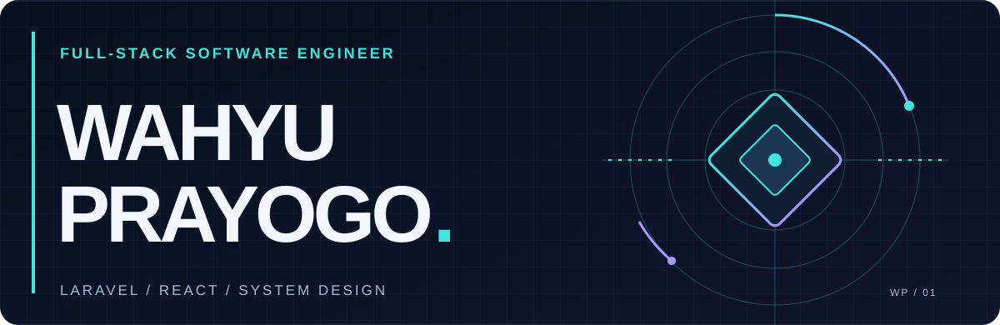

  

 

  <strong>I turn complex workflows into web experiences that feel simple.</strong>
   
  From system design and Laravel backends to React interfaces, I enjoy building the whole thing.
    
  <strong>Open to work opportunities</strong> &nbsp;·&nbsp;
  <a href="https://github.com/WahyuPrayogo1">View my GitHub ↗</a>

 

## 01 / What I bring to the table

| Layer | My focus |
| :--- | :--- |
| **System design** | Making sense of business rules, data, and how each part connects. |
| **Backend** | Building application logic and workflows with Laravel. |
| **Frontend** | Turning those workflows into clear interfaces with React and JavaScript. |

I care about the full journey: understanding the problem, shaping the system, making it work, and refining how people use it.

## 02 / Tools I actually use

`Laravel` &nbsp; `React` &nbsp; `JavaScript` &nbsp; `HTML` &nbsp; `CSS` &nbsp; `Tailwind CSS`

**Strongest areas:** Laravel and system design.

## 03 / Problems I've worked on

| Space | Examples |
| :--- | :--- |
| **AI & learning** | PDF-based RAG for an LMS; an online library. |
| **Operations** | IPOMS; beauty-product stock management. |
| **Booking & commerce** | Villa reservations; a broker platform; WordPress stores and company profiles. |
| **Water management** | A water-source system with web and Android components. |

These projects are in private repositories or belong to other people, so I share the problem areas without publishing their code.

## 04 / A little room for experiments

I also like giving technical ideas a visual world of their own. This animated city is one of those experiments.

  
   
  THE DEVELOPER MULTIVERSE &nbsp; / &nbsp; BUILD · EXPERIMENT · REFINE

 

  <strong>Let's build something useful.</strong>
    
  <a href="https://github.com/WahyuPrayogo1">GitHub profile ↗</a>
  &nbsp;&nbsp;·&nbsp;&nbsp;
  <a href="https://github.com/WahyuPrayogo1?tab=repositories">Public repositories ↗</a>

