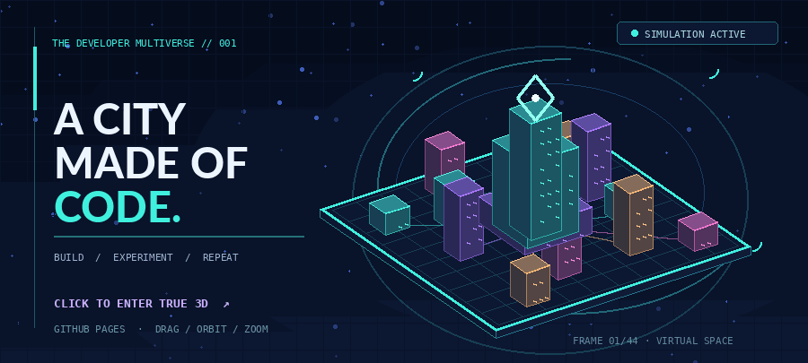

  <picture>
    <source media="(prefers-color-scheme: dark)" srcset="./dark.svg" />
    <source media="(prefers-color-scheme: light)" srcset="./light.svg" />
    
  </picture>
    
  <strong>From complex flows to clear products.</strong>
   
  I work across system design, Laravel backends, and React interfaces to build web applications people can actually use.

 

## About me

I'm a **Software Engineer** who enjoys working across the journey from business logic to the final screen. Laravel and system design are my strongest areas. I also build interfaces with React and care about performance and usability along the way.

I'm currently **open to work opportunities**.

## What I've worked on

| Area | Work |
| :--- | :--- |
| **AI & education** | PDF-based RAG for an LMS; an online library. |
| **Business operations** | IPOMS; beauty-product stock management. |
| **Booking & commerce** | Villa reservations; a broker platform; WordPress stores and company profiles. |
| **Water management** | A water-source system with web and Android components. |

These projects are in private repositories or belong to other people, so I describe the work without publishing their code.

## Engineering stack

| Focus | Tools and skills |
| :--- | :--- |
| **Backend** | Laravel |
| **Frontend** | React, JavaScript, HTML, CSS, Tailwind CSS |
| **Architecture** | System design, business workflows |

## A visual side project

I also enjoy experimenting with how technical ideas can be presented. This animated city is one of those explorations.

  
   
  THE DEVELOPER MULTIVERSE &nbsp; / &nbsp; BUILD · EXPERIMENT · REFINE

 

  <strong>Let's build something useful.</strong>
    
  <a href="https://github.com/WahyuPrayogo1">GitHub profile ↗</a>
  &nbsp;&nbsp;·&nbsp;&nbsp;
  <a href="https://github.com/WahyuPrayogo1?tab=repositories">Public repositories ↗</a>

